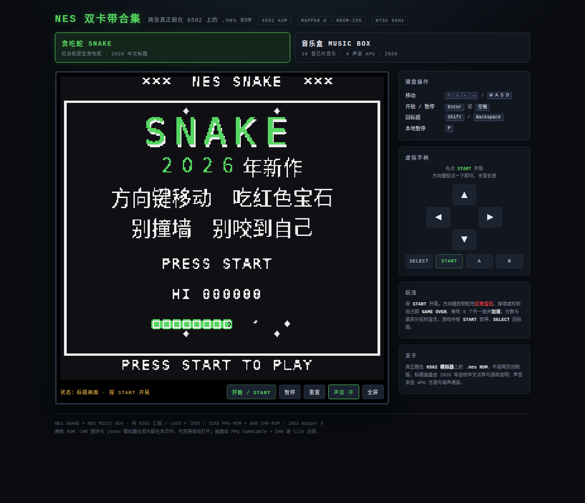
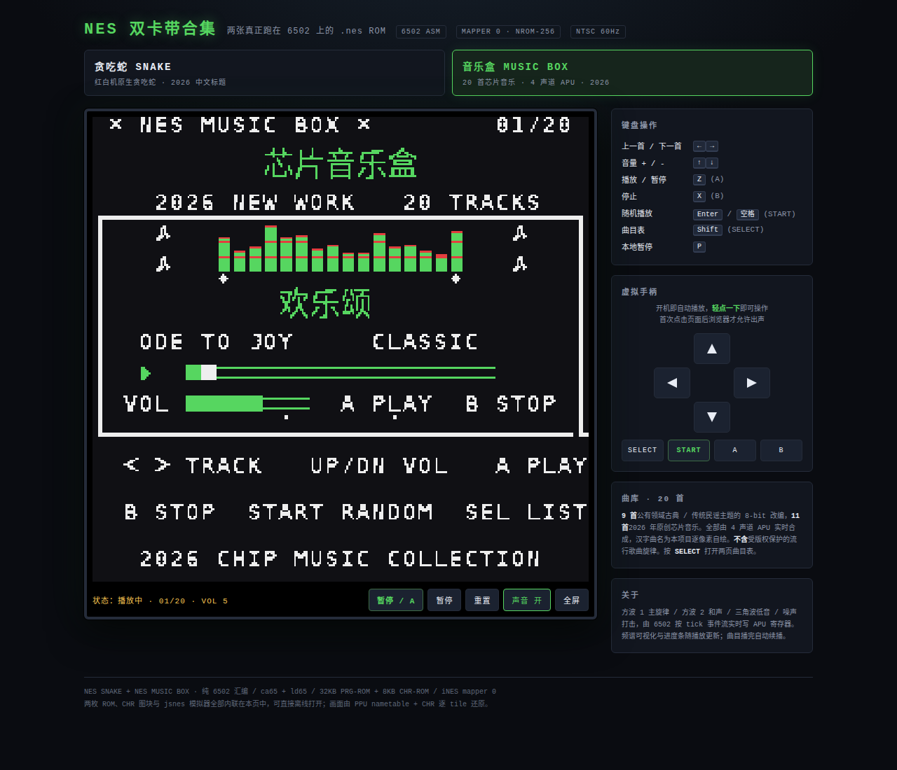

# NES 双卡带合集 · 贪吃蛇 + 音乐盒

两款用 **6502 汇编**从零写成的红白机（NES / FC）原生程序，附一个自包含的浏览器试玩页。

| 卡带 | ROM | 说明 |
|---|---|---|
| 贪吃蛇 SNAKE | `nes-snake/snake.nes` | 完整可玩，标题画面含 2026 年自绘中文点阵 |
| 音乐盒 MUSIC BOX | `nes-music/music.nes` | 20 首芯片音乐，4 声道 APU 实时合成 |

## 在线试玩

直接打开仓库根目录的 [`index.html`](index.html)（或 `nes-snake/play.html`）——单文件、可离线、无需服务器。顶部按钮可在两个程序间随时切换，`?game=music` / `?game=snake` 可直达。

也可以把两枚 `.nes` 拖进 FCEUX / Mesen / Nestopia / RetroArch 等任意 NES 模拟器运行。

## 目录

- `index.html` `nes-snake/play.html` — 自包含双卡带试玩页（内联 jsnes、两枚 ROM、两套 CHR）
- `nes-snake/` — 贪吃蛇工程：6502 源码、CHR 字模、构建与验证脚本
- `nes-music/` — 音乐盒工程：曲库、APU 引擎、构建与验证脚本
- **[完整工程文档](nes-snake/README.md)** — 硬件规格、实现要点、从零构建、验证结果

## 验证

| 项目 | 结果 |
|---|---|
| 贪吃蛇 ROM `node nes-snake/tools/verify.js` | 15/15 |
| 音乐盒 ROM `node nes-music/tools/verify.js` | 30/30 |
| 双卡带页面浏览器回归（Chromium + CDP） | 47/47 |

> 音乐盒收录的是公有领域古典 / 传统民谣的 8-bit 改编与 2026 原创芯片音乐，**不含**受版权保护的当代流行歌曲旋律。
