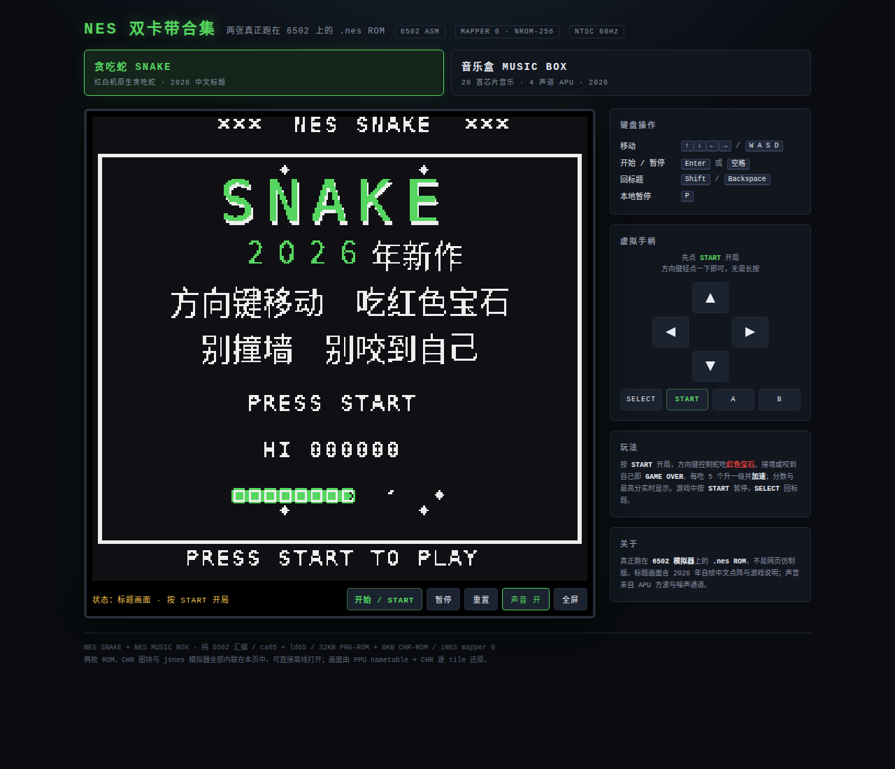
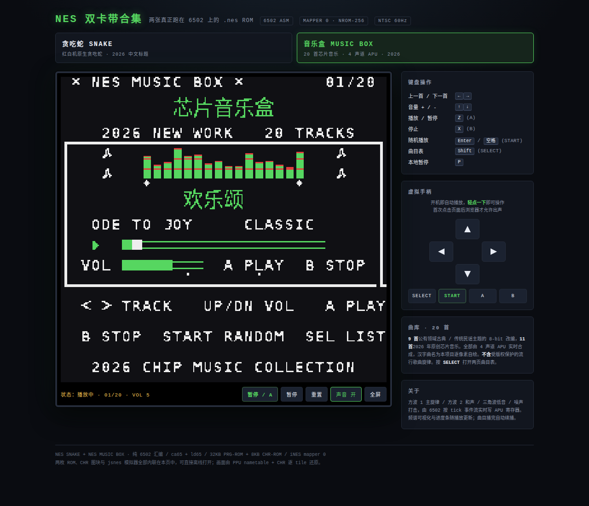
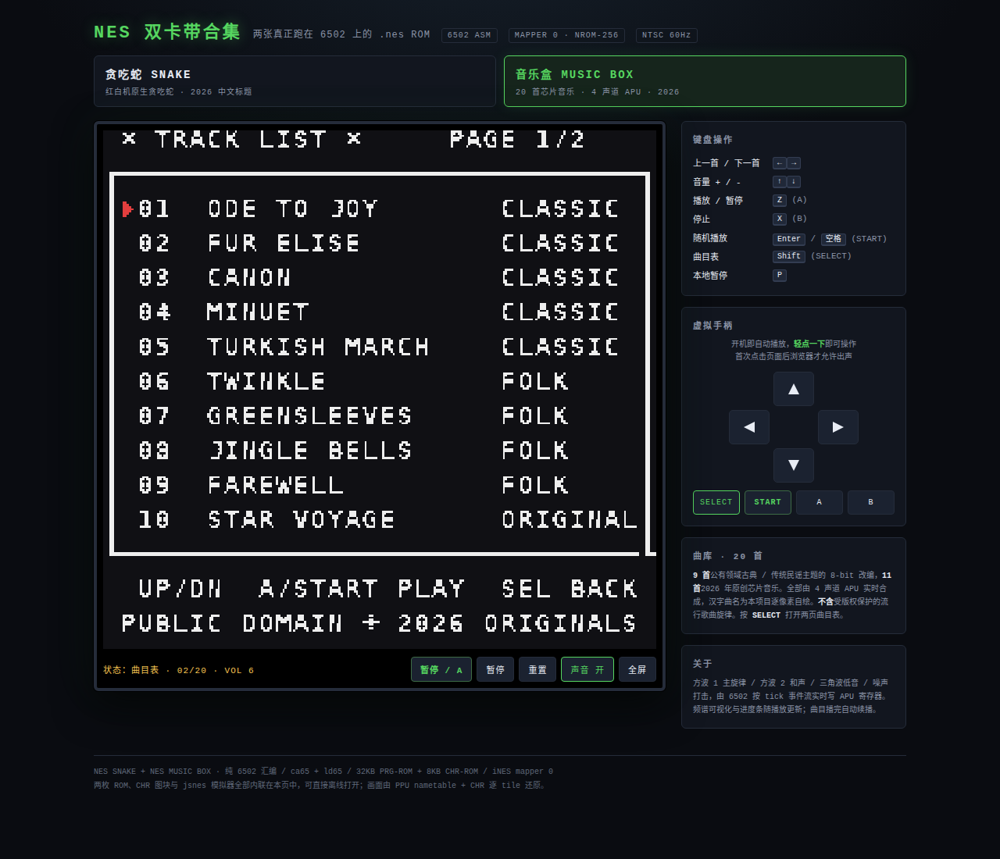

# NES 双卡带合集 · 贪吃蛇 + 音乐盒

两款**真正跑在 6502 上的 NES / FC 程序**：从 6502 汇编、CHR 图块到 `.nes` ROM 全部从零生成，不是网页仿制版。

| 卡带 | ROM | 内容 |
|---|---|---|
| 贪吃蛇 SNAKE | `nes-snake/snake.nes` | 完整可玩的贪吃蛇，标题画面含 2026 年自绘中文 |
| 音乐盒 MUSIC BOX | `nes-music/music.nes` | 20 首 8-bit 芯片音乐，4 声道 APU 实时合成 |







> **2026 年新作**：贪吃蛇标题画面上的 `2026年新作`、`方向键移动 吃红色宝石`、`别撞墙 别咬到自己` 是**自己画进 CHR-ROM 的中文点阵**。红白机原生没有中文字库，老游戏不可能有这套字，这正是本作诞生于 2026 年的证据。

## 立即试玩

- **最简单**：用浏览器打开 [`play.html`](play.html)，或工作区顶层的 [`../index.html`](../index.html)。两者内容相同，都是**自包含单文件**（内联 jsnes 模拟器、两枚 ROM、两套 CHR），可离线使用。
- 页面顶部两个卡带按钮可**随时切换**贪吃蛇 / 音乐盒；切换时会同步替换 CHR 图块、重新加载 ROM、更换右侧说明面板与状态栏。
- URL 参数：`?game=music` 直接进音乐盒，`?game=snake` 直接进贪吃蛇；`?start=1` 让贪吃蛇自动开局。
- 也可以把 `snake.nes` / [`../nes-music/music.nes`](../nes-music/music.nes) 单独拖进 FCEUX / Mesen / Nestopia / RetroArch 等任意 NES 模拟器。

## 卡带一 · 贪吃蛇 SNAKE

### 操作

| 按键 | 功能 |
|---|---|
| 方向键 / `W A S D` | 移动（禁止 180° 掉头） |
| `Enter` / `空格` | START：开始、暂停、GAME OVER 后重开 |
| `Shift` / `Backspace` | SELECT：回到标题画面 |
| `P` | 网页端本地暂停 |
| `Z` / `X` | A / B（本作未使用） |

网页画面栏有一个醒目的 **开始 / START** 按钮，右侧（窄屏时在画面正下方）还有虚拟手柄，手机/平板可直接触摸。

> **轻点一下即可，无需长按。** ROM 每帧只读一次手柄，网页端做了**输入锁存**：每次点击至少保持 4 帧，连续点击之间强制插入一帧松开（保证 START 的按下边沿被看到），并带窗口级释放兜底与 3 秒按住超时，避免短点击被吞掉或指针滑出按钮导致方向键卡住。

### 玩法

吃红色宝石 +10 分、蛇身加长；撞墙或咬到自己即 GAME OVER。每吃 5 个升一级并加速（移动间隔从 12 帧递减到 4 帧）。HUD 实时显示分数、最高分、等级和已吃数量；食物会闪烁，吃食物与死亡都有 APU 音效。

### 实现要点

- **纯 6502 汇编**，用 `ca65` 汇编 + `ld65` 链接，没有 C 运行时、没有第三方游戏库。
- **整屏重画**在关闭渲染与 NMI 期间直接写 PPU；运行时只在 vblank 通过**绘制队列**增量写少量 tile，避免超出 vblank 带宽。
- **蛇身用 256 项环形队列**，8 位索引自增自然回绕；`head_idx` / `tail_idx` 分别移动，不需要搬数组。
- **防掉头**：`newdir EOR dir == 2` 即反向，直接拒绝。不吃食物时自撞检查会跳过即将腾空的尾格。
- **计分用 BCD 数组手动进位**（2A03 的十进制模式被禁用，不能用 `SED`）。
- **食物生成**：8 位 LFSR 混入帧计数，拒绝采样落在蛇身上的位置。
- **音效**：SQ1 播放吃食物/开局音，SQ2 下降扫频 + 噪声通道播放死亡音，NMI 里逐帧更新音量包络。
- **画面闪烁**：NMI 周期性改写 `$3F03`，让红色元素在亮红/黑之间脉动。
- **中文点阵自绘**：`tools/make_chr.py` 用 Noto Sans CJK SC Regular 16px 把汉字渲染成 16×16 点阵，每个字占 2×2=4 个 tile（数字 `2026` 用绿色突出）；共 23 个字符 / 92 个 tile。`src/tiles.inc` 以 `CN_MAP_HEX` 码点表把字表同步给 `make_screens.py`，两侧不会错位。

## 卡带二 · 音乐盒 MUSIC BOX

### 曲库与版权取舍

需求里点名的周传雄《黄昏》、刘德华《谢谢你的爱》等属于**受版权保护的当代流行歌曲旋律**，逐音符复刻进 ROM 会构成复制，因此没有收录。改为按 NES 内存容量尽量多放的合规曲库：

- **9 首公有领域**古典 / 传统民谣主题的 8-bit 改编（5 首古典 + 4 首民谣）；
- **11 首 2026 年原创**芯片音乐（本项目新写）。

共 **20 首**，全部由 APU 实时合成，汉字曲名为本项目逐像素自绘。若日后拿到授权曲谱，可通过 `../nes-music/tools/songlib.py` + `make_songs.py` 编译加入（见下）。

| 分类 | 曲目 |
|---|---|
| CLASSIC（5） | 欢乐颂 ODE TO JOY、爱丽丝 FUR ELISE、卡农 CANON、小步舞 MINUET、进行曲 TURKISH MARCH |
| FOLK（4） | 小星星 TWINKLE、绿袖子 GREENSLEEVES、铃儿响 JINGLE BELLS、送别 FAREWELL |
| ORIGINAL（11） | 星海 STAR VOYAGE、夜曲 NOCTURNE、像素心 PIXEL HEART、霓虹 NEON RUN、晨雾 MISTY WOODS、星夜 STARRY NIGHT、晨星 MORNING STAR、海雾 SEA MIST、霓虹夜 NEON NIGHT、小夜曲 SERENADE、像素曲 PIXEL GROOVE |

### 操作

| 按键 | 功能 |
|---|---|
| `←` / `→` | 上一首 / 下一首（列表页为翻页） |
| `↑` / `↓` | 音量 + / -（列表页为上下选曲） |
| `Z` (A) | 播放 / 暂停；列表页播放选中曲目 |
| `X` (B) | 停止并归零进度；列表页返回播放页 |
| `Enter` / `空格` (START) | 播放页随机播放；列表页播放选中曲目 |
| `Shift` (SELECT) | 打开 / 关闭两页曲目表 |
| `P` | 网页端本地暂停 |

开机即自动播放第 1 首；曲目播完自动续播下一首。画面栏绿色按钮在音乐盒下相当于 **A**（播放 / 暂停）。

> 浏览器要求首次点击页面后才允许出声，任意点击或按键都会解锁音频。

### 界面

播放页显示中文「芯片音乐盒」、`2026 NEW WORK 20 TRACKS`、绿色汉字曲名、英文曲名、CLASSIC / FOLK / ORIGINAL 分类、**16 列频谱柱**、进度条、8 格音量条、播放状态图标与 `01/20` 编号。曲目表分两页、每页 10 首，带选中游标与底部说明。

### 硬件与内存

| 项目 | 值 |
|---|---|
| 卡带 | Mapper 0 / NROM-256：32KB PRG-ROM + 8KB CHR-ROM |
| PRG 有效数据 | 约 14,235 字节（13.9 KB / 32 KB，剩余 18.1 KB） |
| 曲目数据 | 20 首 / 41 汉字 / 1,387 事件 / 约 9,202 字节 |
| CHR | 240 / 256 个 8 位 tile（ASCII 51 + UI 25 + 汉字 41×4） |
| 调色板 | 与贪吃蛇相同 4 色（黑 `$0F` / 白 `$30` / 绿 `$2A` / 红 `$16`） |

### 实现要点

- **4 声道 APU**：SQ1 主旋律、SQ2 自动和声、TRI 低音、NOISE 打击；6502 按 tick 事件流逐事件写 APU 周期/音量寄存器。
- **曲目编译格式**：每个事件 6 字节 `[dur, sq1, sq2, tri, noise, bar]`；`0` 静音、`1..60` 音高索引、`$FE` 保持、`dur=0` 曲末，`bar` 为预计算的 0–20 进度条位置。
- `songlib.py` 定义记谱法与 20 首曲目、APU 周期表、噪声打击表，并自动派生和声/低音/打击；`make_songs.py` 编译成纯 ASCII 的 `src/songs.inc`（中文以十六进制码点注释传递，避免 `.inc` 编码错误）。
- **NMI 只负责 flush 绘制队列**；切歌 / 回播放页时用 `show_screen` 整屏重画，并在 `direct_mode=1` 时直接写 PPU，避免主循环与 NMI 并发写队列导致动态内容丢失。
- 频谱柱、进度条、音量条在列表页不写入，防止污染曲目表。

## 网页合集页

- **双卡带选择器**：`GAMES` 数组内联两套 ROM + CHR 的 base64；`switchGame(i)` 做 `releaseAll()` → 替换 `chr` → `nes.loadROM(romStr)` → 更换右侧说明面板 → `bindPad()` 重新绑定虚拟手柄 → 重绘。
- **画面还原**：不依赖 jsnes 的帧缓冲，而是读 PPU nametable + 当前卡带的 CHR 逐 tile 画到 `<canvas>`。两个 ROM 都用同一组 4 色调色板，故可共用颜色表。
- **状态栏按卡带适配**：贪吃蛇读 `$0004` state 显示标题 / 游戏中 / GAME OVER；音乐盒读 `$0004~$0007`（state / playing / song_idx / volume）显示「曲目表 / 播放中 / 已暂停 · 01/20 · VOL 5」。
- **音频**：`AudioContext` + `createScriptProcessor` + `Float32Array` 环形缓冲，`onAudioSample(l,r)` 收集 APU 样本；切换或重置时清空队列。
- **重置不用 `nes.reset()`**：jsnes 2.1.0 的 `reset()` 会重建 CPU 却没重写 PRG-ROM，复位向量变 `$0000`，几帧后即 `invalid opcode at $1FD` 崩溃。重置按钮改为 `nes.loadROM()` 重新加载**当前卡带**（冷启动），同时清除错误提示、解除崩溃时主循环的自锁、复位按钮与状态文案。
- **输入锁存**：`down()` / `up()` 不直接对应模拟器按键电平，而是由 `syncInput()` 按帧维护「保底 4 帧 + 物理按住倒计时」；指针用 `setPointerCapture` 捕获，配合 `window` 级 `pointerup` / `blur` / `visibilitychange` 兜底。
- **移动端**：窄屏把卡带按钮改为双列、压缩行高、虚拟手柄面板用 `order:-1` 提到画面正下方，390×844 视口下四个方向键与绿色开始按钮都在首屏内，且无横向溢出。方向键用纯 CSS 几何三角形，不依赖字体渲染。

## 文件清单

| 文件 | 说明 |
|---|---|
| `snake.nes` | 贪吃蛇 ROM（可直接在模拟器运行） |
| `play.html` `../index.html` | 自包含双卡带合集试玩页 |
| `src/snake.s` | 贪吃蛇主源码（6502 汇编） |
| `src/snake.cfg` | ld65 链接配置（NROM-256 内存布局） |
| `src/tiles.inc` `src/layout.inc` `src/screens.inc` | 生成物：图块常量、HUD 坐标、三张 960 字节 nametable |
| `tools/make_chr.py` | Pillow 渲染英文字模 + 16×16 中文点阵，生成 8KB CHR |
| `tools/make_screens.py` | 生成贪吃蛇三张画面 |
| `tools/build.py` | 拼接 iNES 头 + PRG + CHR |
| `tools/arcade.template.html` | 双卡带合集页模板（选择器、两套面板、输入锁存、音频） |
| `tools/make_play.py` | 读取两枚 `.nes` + 两套 `chr.bin`，生成 `play.html` 与 `../index.html` |
| `tools/verify.js` `tools/render_shots.py` | jsnes 逻辑断言（15 项）/ nametable 快照渲染 PNG |
| `tools/shots/arcade_0*.png` | 合集页六张浏览器回归截图 |
| `../nes-music/music.nes` | 音乐盒 ROM |
| `../nes-music/src/music.s` | 音乐盒主源码（APU 引擎 + 播放器） |
| `../nes-music/tools/songlib.py` `make_songs.py` | 曲库单一数据源 / 编译成 `src/songs.inc` |
| `../nes-music/tools/make_chr.py` `make_screens.py` `build.py` | 音乐盒 CHR / 三张画面 / iNES 打包 |
| `../nes-music/tools/verify.js` | 音乐盒 30 项逻辑断言 |
| `build.sh` `../nes-music/build.sh` | 各自的一键构建 |

## 从零构建

```bash
sudo apt install cc65 fonts-noto-cjk   # ca65 / ld65 + 简体中文字体
pip3 install pillow                    # 生成字模与中文点阵图块

cd nes-snake && ./build.sh             # 生成 chr.bin、snake.nes
cd ../nes-music && ./build.sh          # 生成 songs.inc、chr.bin、music.nes
cd ../nes-snake && python3.11 tools/make_play.py   # 生成双卡带 play.html + ../index.html
```

`make_chr.py` 通过 `fc-match "Noto Sans CJK SC:style=Regular"` 定位中文字体；未安装时回退到系统默认路径。NES nametable 的 tile 索引只有 8 位（0–255），加中文字符会消耗 4 个 tile/字，需保证总索引 ≤ 255。

## 验证

```bash
cd nes-snake && node tools/verify.js            # 贪吃蛇 15/15
cd ../nes-music && node tools/verify.js         # 音乐盒 30/30
python3.11 tools/render_shots.py                # 各自导出 nametable PNG
```

- **贪吃蛇 15/15**：冷启动进入标题、START 开局、吃食物加分与增长、食物重新生成、转向、暂停冻结、撞墙 GAME OVER、重开、SELECT 回标题。
- **音乐盒 30/30**：冷启动自动播放、APU 非静音、事件指针推进、进度条变化、切歌、音量、暂停恢复、停止、两页曲目表、翻页、选中播放、播完自动续播、未崩溃。音频总样本 730,816 / 非静音 730,742 / 峰值 0.763。
- **合集页 47/47**（无头 Chromium + CDP 注入真实鼠标/键盘事件，并读取 ROM 零页状态）：默认卡带与按钮高亮、画面非空、CHR 与当前卡带一致、贪吃蛇短点击 START / 方向键 / SELECT、切换音乐盒后 CHR 同步与状态栏、开机自动播放与音频队列非静音、切歌 / 音量 / 曲目表 / A 暂停、音乐盒重置回第 1 首与 VOL 5、切回贪吃蛇后手柄重绑与连点 3 次重置、`?game=music` / `?game=snake`、声音开关、390×844 移动端无溢出且方向键完整在首屏。
- 重置专项：游戏中重置回标题且无报错、重置后重新开局、连点 3 次重置、人为触发崩溃后再点重置能清除错误并恢复可玩。

## 已知限制

- NES 属性表的调色板粒度是 4×4 tile，无法给每个格子单独配色，因此两个程序全屏共用一组 4 色调色板。
- 未使用精灵与滚动；贪吃蛇蛇长上限 250。
- NES 没有中文字库，中文均为**自绘 16×16 点阵**，只收录实际用字；HUD 与结束画面仍为英文（加字会占用更多 CHR 与 8 位 nametable 索引）。
- 8px ASCII 字模放大后个别字符（如 `B` / `6`、`J` / `3`）观感相近，属点阵字模限制。
- 试玩页用 16ms 定时器驱动约 60Hz，浏览器在后台标签会节流，属正常现象。
- 音乐盒未收录受版权保护的流行歌曲旋律，详见「曲库与版权取舍」。
